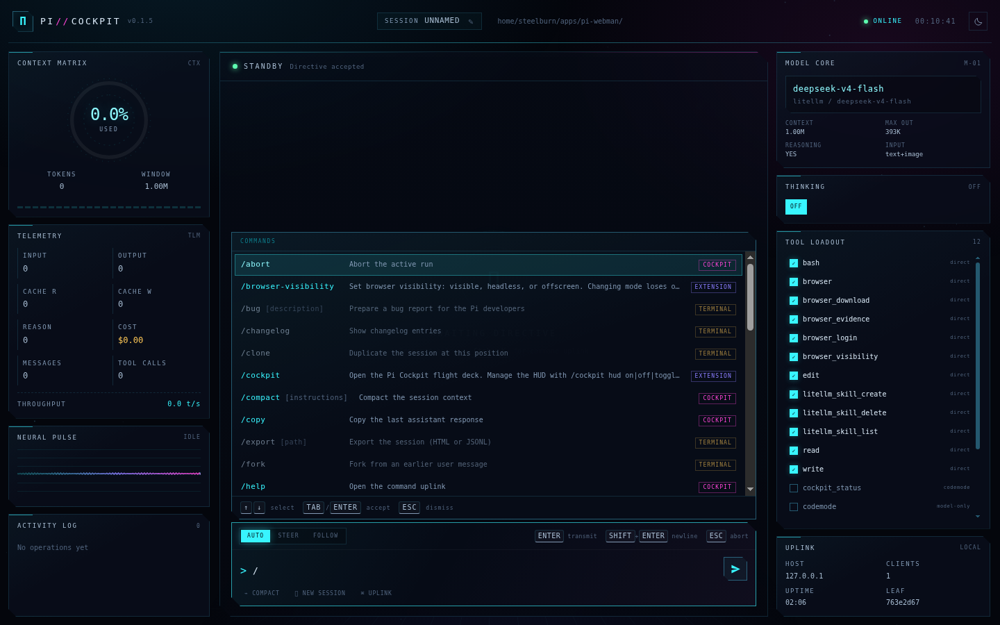
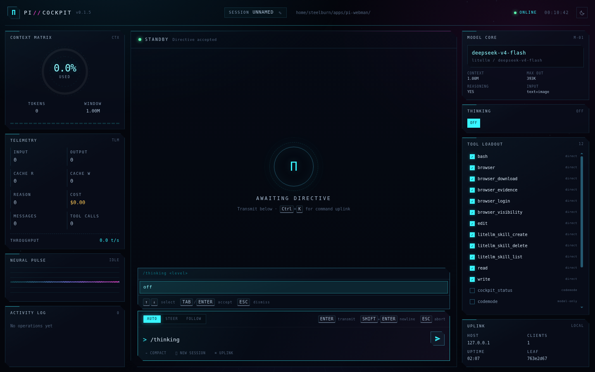

# π Webman — Pi // Cockpit

A futuristic browser cockpit for the [Pi coding agent](https://pi.dev). It puts a live
flight deck around the Pi session already running in your terminal: streaming transcript,
token flux, context pressure, model core, thinking level, tool loadout, activity log,
command uplink and a keyboard-driven command palette.

Inspired by the terminal flight deck and telemetry of its sibling HUD extension
[`pi-cockpit-hud`](https://github.com/steelburn/pi-cockpit-hud), rebuilt as a
zero-dependency local web UI served by a Pi extension.


A real run: directive in, tool calls, a streamed answer and live telemetry —
[full-resolution MP4](https://github.com/steelburn/pi-webman/releases/download/v0.1.5/cockpit-demo.mp4).

## Highlights

- **Live stream** — user directives, assistant text, hidden reasoning, tool calls and tool
  output arrive over Server-Sent Events. Reconnects hydrate from a full session snapshot.
- **Flight telemetry** — context gauge, input/output/cache tokens, reasoning tokens, cost,
  throughput, message and tool-call counters, mission uptime and session leaf.
- **Tool operations** — expandable HUD cards for every tool call, including input, output,
  status, duration and coloured diffs when a tool returns a patch.
- **Control surface** — send, steer or follow up; abort; switch model; change thinking
  level; enable/disable tools; rename the session; compact context; start a new session
  (interactive mode); switch between light and dark mode.
- **Command uplink** — `Ctrl/Cmd+K` palette for actions, models, Pi slash commands and tools.
- **`/` completion** — type `/` in the composer for fuzzy command search with argument
  completion for models and thinking levels, matching Pi's terminal editor.
- **Extension popups** — dialogs an extension opens in the terminal are mirrored as a
  native modal in the cockpit, and extensions that opt in through the popup bridge get
  the answer back (see [Extension popups](#extension-popups)).
- **Light & dark modes** — toggle from the top bar or the command uplink. The cockpit follows
  the OS preference on first visit, remembers your choice, and recolours the HUD, transcript
  and background canvases together.
- **Retro-futurist HUD** — neon grid, starfield, scanlines, context ring, neural pulse and
  status LEDs. Reduced-motion preferences are respected.
- **No runtime dependencies** — only Node built-ins. The UI is bundled into the extension.

## Install

From the [Pi package catalog](https://pi.dev/packages/pi-webman):

```bash
pi install npm:pi-webman
```

From a checkout of this repo:

```bash
pi install "$(pwd)"
```

Or load it for a single run while developing:

```bash
pi -e ./src/index.ts
```

Pi loads TypeScript extensions directly through `jiti`; there is no compile step.

## Start the cockpit

Inside Pi's terminal UI:

```text
/web                 start on http://127.0.0.1:4747/
/web 5000            start on a custom port
/web open            start and open the default browser
/web status          show the URL and connected clients
/web restart         restart the server
/web stop            stop the server
/webman              alias for /web
```

The URL is also printed as a Pi notification and shown in the footer as `◈ WEB :4747`.
Use `Ctrl+C` in the browser or leave the tab open; the server follows the Pi session.

### Start automatically

```bash
pi --web
pi --web --web-port 5000
pi --web --web-open
```

The cockpit is restored automatically after `/reload` when it was running.

### Flags

| Flag | Default | Meaning |
| --- | --- | --- |
| `--web` | off | Start the cockpit when a session starts |
| `--web-port` | `4747` | Listening port (`0` picks a free port) |
| `--web-host` | `127.0.0.1` | Bind interface |
| `--web-token` | empty | Require a bearer token / cookie for access |
| `--web-open` | off | Open the default browser on start |

Environment equivalents: `PI_COCKPIT_PORT`, `PI_COCKPIT_HOST`, `PI_COCKPIT_TOKEN`.

## Cockpit guide

| Area | What it does |
| --- | --- |
| **Top bar** | Brand, session callsign, working directory, uplink state, wall clock |
| **Context Matrix** | Context-window ring, used/window tokens, segment bar |
| **Telemetry** | Input, output, cache read/write, reasoning, cost, messages, tool calls |
| **Neural Pulse** | Live waveform fed by streamed text/thinking deltas |
| **Activity Log** | Running and recently completed tools with duration |
| **Transcript** | Markdown messages, collapsible thoughts, expandable tool cards |
| **Composer** | `AUTO` / `STEER` / `FOLLOW` delivery modes, prompt history, quick actions |
| **Model Core** | Current model and a searchable model palette |
| **Thinking** | Supported thinking levels for the active model |
| **Tool Loadout** | Toggle active tools on the next model request |
| **Uplink** | Host, SSE clients, uptime, branch leaf |

### Keyboard

| Key | Action |
| --- | --- |
| `Enter` | Transmit directive, or run the highlighted command |
| `Shift+Enter` | Newline |
| `Tab` | Accept the highlighted command or argument |
| `↑` / `↓` | Move through the `/` menu, or the command uplink |
| `Esc` | Dismiss the `/` menu or palette, otherwise abort the active run |
| `Ctrl/Cmd+K` | Open or close the command uplink |
| `↑` (empty composer) | Recall previous directive |

`AUTO` sends immediately when idle and queues a follow-up when Pi is busy. `STEER` enters
after the current assistant turn and its tool calls. `FOLLOW` waits until the run settles.

## Commands

Typing `/` in the composer opens the same command surface as Pi's terminal editor:



Each entry is tagged with where it runs:

| Badge | Meaning |
| --- | --- |
| `COCKPIT` | Executed by the browser against the cockpit API — never sent to the model |
| `EXTENSION`, `PROMPT`, `SKILL` | Real Pi commands, forwarded to the session |
| `TERMINAL` | A Pi builtin that only the interactive editor can run |

Cockpit commands:

| Command | Effect |
| --- | --- |
| `/compact [instructions]` | Compact the context, optionally with custom instructions |
| `/model [provider/model]` | Switch the model core (argument completion) |
| `/thinking <level>` | Set the thinking level (argument completion) |
| `/name <callsign>` | Rename the session |
| `/new` | Start a new session |
| `/abort` | Abort the active run |
| `/theme [light\|dark]` | Toggle or set the cockpit theme |
| `/copy` | Copy the last assistant response |
| `/status` | One-line session summary |
| `/help` | Open the command uplink |

`TERMINAL` commands are listed so the surface is honest, but they are refused rather than
forwarded: Pi handles its builtins in the interactive editor, so sending `/quit` or
`/thinking low` as a prompt would otherwise be billed to the model as text.



## Extension popups

Pi renders extension dialogs in the terminal, and the extension API does not let one
extension read or answer another's dialog — it only reports that a prompt is waiting. The
cockpit therefore covers both cases:

1. **Nothing to install.** While any extension dialog is open, the composer shows a
   `TERMINAL PROMPT` banner with the prompt kind and title, so the browser never looks
   frozen and you know to answer in the terminal.
2. **Popup bridge.** Extensions can render their popup in the browser instead and receive
   the answer, over the shared `pi.events` bus:

```ts
import type { ExtensionAPI } from "@earendil-works/pi-coding-agent";

export default function (pi: ExtensionAPI) {
  pi.events.on("webman:popup:answer", (answer) => {
    console.log(answer); // { id, value } or { id, cancelled: true }
  });

  pi.registerCommand("hud", {
    description: "Open the HUD",
    handler: async (_args, ctx) => {
      pi.events.emit("webman:popup:open", {
        id: `hud-${Date.now()}`,
        kind: "select", // select | confirm | input | notice
        title: "DOCKER HUD",
        message: "3 containers running",
        options: [
          { value: "api", label: "api-7f9c", description: "up 3 hours · :8080" },
          { value: "db", label: "postgres-1a2b", description: "up 3 hours · :5432" },
        ],
        source: "my-extension",
      });
    },
  });
}
```

Channels:

| Channel | Direction | Payload |
| --- | --- | --- |
| `webman:popup:open` | extension → cockpit | popup spec (`id`, `kind`, `title`, `message?`, `options?`, `placeholder?`, `allowCancel?`, `source?`) |
| `webman:popup:answer` | cockpit → extension | `{ id, value? , cancelled? }` |
| `webman:popup:close` | either way | `{ id }` — dismiss without an answer |
| `webman:popup:ping` / `pong` | extension ⇄ cockpit | `{ id }` → `{ id, url, version, clients }`, to check whether a browser is listening |
| `webman:popup:ready` | cockpit → extensions | `{ url, version, clients }` when the server starts |

A runnable extension that implements all of it — including falling back to a terminal
dialog when no browser is connected — lives in
[`examples/popup-bridge-demo.ts`](examples/popup-bridge-demo.ts):

```bash
pi -e ./examples/popup-bridge-demo.ts --web
/hud-demo      # select popup, answered in the browser
/hud-notice    # notice popup
/hud-terminal  # counter-example: terminal-only dialog, mirrored as a banner
```

## Security

- The server binds to `127.0.0.1` by default.
- Binding to a non-loopback host automatically generates a random token. Open the URL that
  Pi prints; it contains the token and sets an `HttpOnly`, `SameSite=Strict` cookie.
- `--web-token` forces token auth even on loopback.
- Responses carry a restrictive CSP, `nosniff`, `X-Frame-Options: DENY` and no-referrer.
- POST endpoints check the request origin.
- For remote access prefer an SSH tunnel or Tailscale instead of exposing plain HTTP:

```bash
ssh -L 4747:127.0.0.1:4747 your-host
```

The cockpit has the same operating-system permissions as the Pi process. Anyone who can
reach it can send prompts and change the active model/tools, so protect the token.

## How it works

```text
src/index.ts     extension entry: flags, /web command, lifecycle events, runtime
src/server.ts    HTTP server, auth, JSON API, SSE endpoint, static assets
src/hub.ts       SSE fan-out with a hydrate-before-stream barrier
src/state.ts     branch-aware session snapshot, telemetry, command catalog
src/popups.ts    extension popup bridge: registry, validation, channels
src/serialize.ts cycle-safe JSON with bounded string sizes
src/assets.ts    generated UI bundle (do not edit)
ui/              source for the HTML/CSS/JS cockpit
scripts/         UI asset bundler
examples/        runnable popup-bridge extension
```

The extension subscribes to Pi lifecycle events (`message_*`, `tool_execution_*`,
`agent_*`, `model_select`, compaction, session changes) and forwards them to the browser.
The browser receives a full snapshot in the SSE `hello` frame, then applies live events.
Session state is persisted as a branch-scoped custom entry (`pi-webman`) so the cockpit can
come back after a runtime reload without polluting model context.

### Coexistence with pi-cockpit-hud

[`pi-cockpit-hud`](https://github.com/steelburn/pi-cockpit-hud) (`npm:pi-cockpit-hud`) is a
separate terminal HUD extension and owns the `/cockpit` command. Webman uses `/web`,
`/webman` and `/web-session`, its own footer status key (`webman`) and its own custom
session entry type (`pi-webman`), so both extensions can be installed at once.

Note: the unrelated `pi-cockpit` package on npm is not part of this project.

## Development

```bash
npm install
npm run build       # bundle ui/* -> src/assets.ts
npm run typecheck
npm run check       # build + typecheck
npm run watch       # rebuild UI on change
```

After changing UI files, rebuild the bundle and restart Pi (or run `/web restart`).
In a separate terminal, a minimal smoke test:

```bash
curl -s http://127.0.0.1:4747/api/health
curl -s http://127.0.0.1:4747/api/state | head -c 400
```

## Limitations

- New sessions are only available when Pi runs in interactive (TUI) mode; RPC/JSON/print
  hosts own their session lifecycle.
- Image attachments and file uploads are not implemented yet.
- The cockpit exposes the current session only; use Pi's session picker to switch sessions.
- Throughput is estimated from streamed deltas; authoritative usage comes from provider
  responses.

## License

MIT
